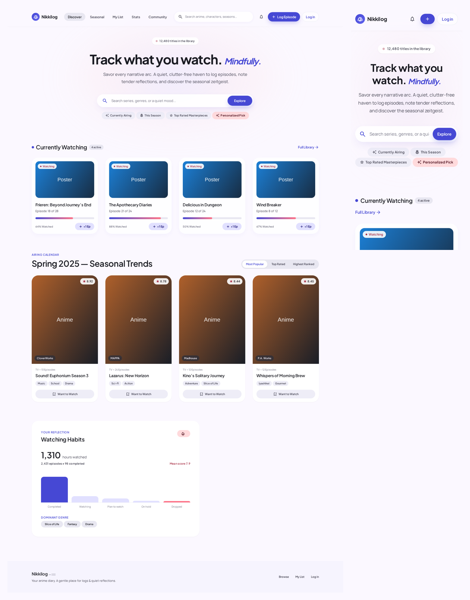
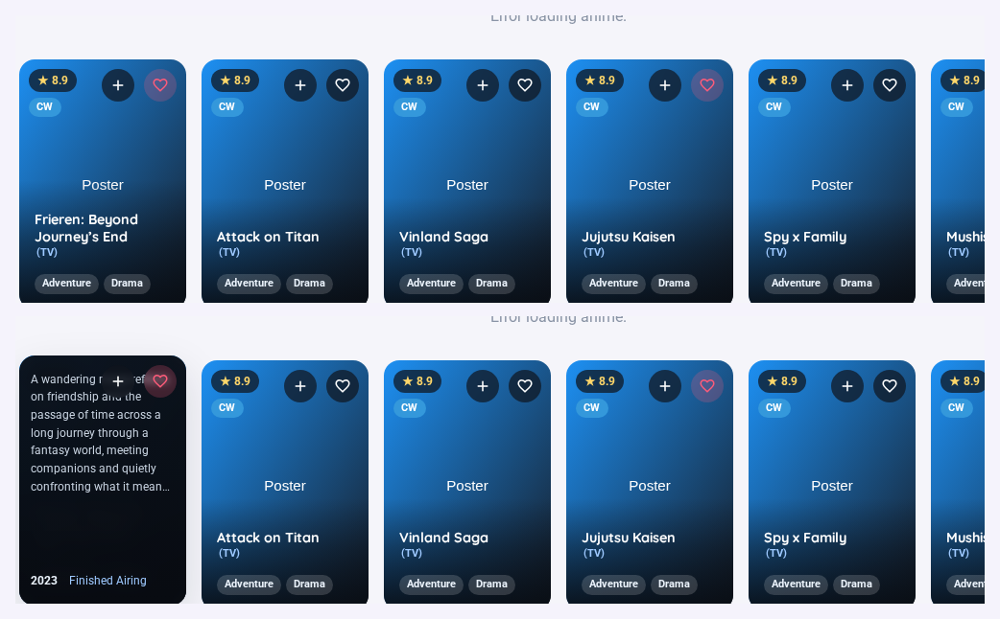
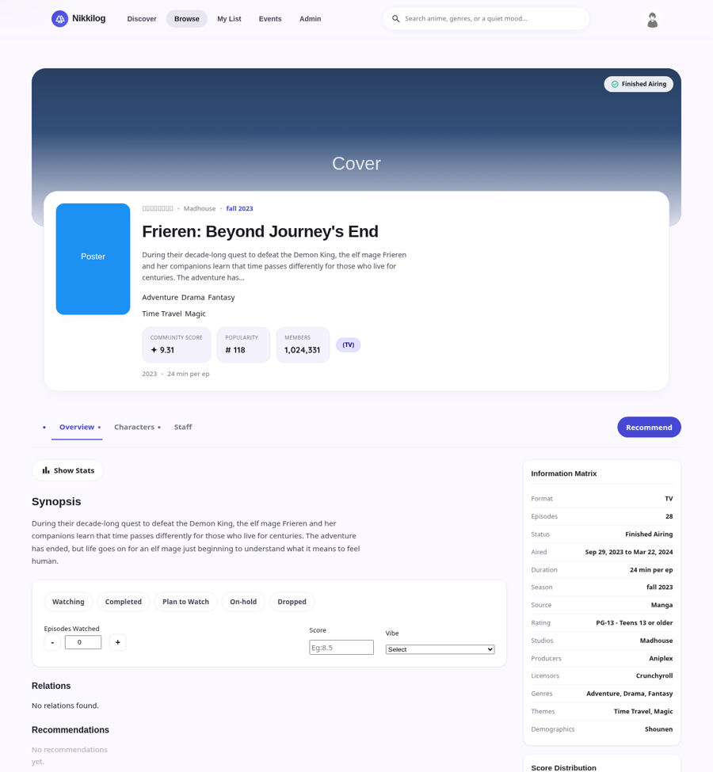

# Nikkilog

**A calm, self-hosted anime tracker.** Browse a catalogue, log what you watch,
rate it, write down what you thought, and see your own statistics — on your own
server, with no ads and no one else's product decisions.



<p align="center">
  
  
</p>

---

## Contents

- [What it does](#what-it-does)
- [What this is not](#what-this-is-not)
- [Quick start](#quick-start)
- [Testing](#testing)
- [How it is built](#how-it-is-built)
- [Roadmap](#roadmap)
- [Contributing](#contributing)
- [Provenance and licensing](#provenance-and-licensing)

---

## What it does

**Track** — status, episode progress, score, a mood, and private notes for every
title. Your list is searchable and sortable, with your own statistics:
episodes watched, hours, days, score distribution, and a breakdown by status.

**Browse** — filter the catalogue by genre, theme, year and season; sort by
score, popularity or recency; and see what is airing this season.

**Reflect** — rate and review what you watch, with likes on other people's
reflections. There is a mood field and a notes field, because "how did this make
you feel" is a more interesting question than a number out of ten.

**Your corner** — profile picture and banner, favourite titles, a favourites
list of anime songs, and a watch-hour leaderboard if you want one.

**Runs the site** — admins get a moderation queue for reported comments, and a
manager for events, announcements and sponsors.

## What this is not

Being clear about this saves everyone time:

- **Not a social network.** There are no friend lists, direct messages or
  activity feeds. Comments are attached to titles, not to people.
- **Not a forum.** There are no boards or clubs.
- **Not a streaming site.** It links out; it does not host video.
- **Not a MyAnimeList replacement.** MAL's value is 20 years of curated data
  and millions of users generating it. This is a personal tool. Features that
  only make sense at that scale — algorithmic feeds, global rankings — are out
  of scope by design.

## Quick start

You need **Node 20+** and **MySQL 8** (or MariaDB 10.6+).

```bash
git clone https://github.com/YOUR-USERNAME/nikkilog-express.git
cd nikkilog-express
npm install
cp .env.example .env       # then fill in SECRET_KEY and your DB_* values
npm run setup-db           # or: npm run import-db -- backup.sql
npm start                  # http://127.0.0.1:5000
```

The database tables are created on first boot, and any columns an older
database is missing are added automatically.

Two helpers you will probably want:

```bash
npm run set-password                 # list accounts, pick one, set its password
npm run import-db -- old-backup.sql  # restore a dump
```

**Forgot a password?** There is no self-service reset yet (see the roadmap) —
`npm run set-password` is the way in.

## Browser extension

`extension/` is a Chrome/Firefox extension that logs what you watch to **your
own** Nikkilog, from any streaming site — silently, with no pop-ups.

MAL-Sync and friends sync to *hosted* services. None of them syncs to a tracker
you run. And unlike them it needs no per-site adapters: it reads the page's
title, heading and URL and parses out the show and episode number, so it works
on sites nobody has written an adapter for.

To use it: create a token at **/settings**, then load `extension/` unpacked
(see [extension/README.md](extension/README.md)).

## Testing

```bash
npm test          # everything (a few minutes — the UI suites drive a browser)
npm run test:fast # skips the browser suites
npm test -- matcher
```


```bash
npm test
```

Eighteen suites, ~320 checks: every page loads without JavaScript errors, the
authentication flow works, the UI layout is asserted numerically (grid columns,
thumbnail sizes, chart heights), and the session store is tested both with a
working database and with a dead one.

Neither a database nor a browser is required — the suites assert how the app
behaves when the database is *unreachable*, and the UI suites skip cleanly if no
Chrome is installed. See [CONTRIBUTING.md](CONTRIBUTING.md#running-the-tests).

## How it is built

| Layer | Choice | Why |
| --- | --- | --- |
| Server | Node 20 + Express 4 | Small, familiar, easy to read |
| Views | EJS | Server-rendered HTML — no build step, no hydration bugs |
| Database | MySQL via `mysql2` | Parameterised queries; no ORM to learn |
| Sessions | MySQL-backed | Logins survive a restart; no filesystem races |
| Styling | Plain CSS + custom properties | `public/css/tokens.css` is the whole design system |
| Auth | scrypt + `express-session` | Email and password only; no third-party sign-in |
| Charts | Chart.js (CDN) | One dependency, no build pipeline |

```
server.js              entry point: database check, then listen
src/
  app.js               Express app: middleware, routes, error handling
  config/              env loading, database pool, startup migration
  middleware/          auth, security headers, uploads
  routes/              one file per feature area
  services/            password hashing, caching, session store, helpers
views/                 EJS templates (+ partials/ for the shared chrome)
public/
  css/tokens.css       the shared design system — start here for styling
  js/                  one script per page
tests/                 the suites
```

Everything is deliberately boring and readable. There is no framework to learn
before you can change something.

## Roadmap

Roughly in order of how much difference each would make. **`good first issue`**
labels on GitHub mark the ones that are safe to start on.

| # | Feature | Why it matters | Difficulty |
| --- | --- | --- | --- |
| 1 | **Password reset** | Right now a forgotten password needs shell access. Needs an email sender. | Medium |
| 2 | **Airing calendar + notifications** | For most people, the reason to use a tracker at all. | Medium |
| 3 | **Import / export (MAL, AniList)** | A list is a user's lock-in; without import you cannot acquire one. | Medium |
| 4 | **Deeper list fields** — rewatch count, start/finish dates, tags, priority | What serious trackers expect. Mostly a migration plus UI. | Easy |
| 5 | **Better search** — franchise grouping, studio filters | Makes the catalogue actually navigable. | Medium |
| 6 | **Manga tracking** | Doubles the catalogue. Needs a data source. | Large |
| 7 | **Email verification + 2FA** | Account safety once there are real users. | Medium |

**Out of scope** (please open an issue before building any of these): a forum,
clubs, friend lists, an algorithmic feed, video hosting.

## Contributing

Contributions are very welcome — especially from people who are learning. The
[CONTRIBUTING guide](CONTRIBUTING.md) covers setup, the test suites, code style,
and how to pick something to work on. It is written for people who are not
full-time developers; if something in it is unclear, that is a bug in the guide.

By taking part you agree to the [Code of Conduct](CODE_OF_CONDUCT.md). To report
a security problem, see [SECURITY.md](SECURITY.md).

## What each command does to your data

Worth stating plainly, because these are your records:

| Command | Effect on existing rows |
| --- | --- |
| `npm run update-anime` | **None.** Insert-only — new titles and their links. It looks up which `mal_id`s you already have and skips them. No `UPDATE`, `DELETE` or `REPLACE` appears anywhere in it. |
| `npm run add-anime` | **None.** Insert-only, by MAL id. |
| `npm run migrate` | **None.** Structure only — adds a table or column when it is missing. Never drops, never alters an existing column. |
| `npm run import-mal` | **This one does overwrite.** It sets status, progress and score for entries you already track. Dry run unless you pass `--apply`, it prints how many would be updated first, and it asks before writing. |

`tests/safewrite.test.js` enforces the first two: it scans the update and migration
code for `UPDATE`/`DELETE`/`DROP`/`REPLACE` and fails if one appears, checks that
every `CREATE TABLE` and `ADD COLUMN` sits behind an existence test, and exercises
the "which ids do I already have" lookup against a fake connection to prove it
issues only `SELECT`s.

## When an import skips a few entries

The import matches on MAL id, so a title that was never fetched into the
catalogue cannot land — it shows up under "not in the catalogue" rather than
being silently dropped. That is a gap in the catalogue, not a fault in the
import.

Add the missing ones by id, then import again:

```bash
npm run add-anime 52991 20 30          # space separated
npm run add-anime "52991, 20, 30"      # or a pasted list
npm run add-anime                      # or paste them when prompted
```

Plain numbers pass through npm fine on Windows; only `--flags` are a problem
there. The import report prints the exact command with the ids already filled in.

`add-anime` fetches each title individually (`/anime/{id}`), writes the same row
`update-anime` would, links its genres and studios, and reports per id: added,
already present, no such title, or failed. It is insert-only — an id already in
the catalogue is left untouched.

## Keeping the catalogue current

New seasons need adding to the `anime` table. Two ways, depending on the job:

```bash
npm run update-anime              # what aired this season that you do not have
npm run update-anime:apply        # insert it
npm run update-anime:upcoming     # include next season too
npm run update-anime:check        # is the metadata source reachable?
```

**On Windows, use those aliases rather than flags.** PowerShell reads a leading
`--` as its decrement operator, so `npm run update-anime -- --apply` fails to
parse before npm is even reached. The aliases pass no arguments through npm, so
no shell can mangle them. For a flag the aliases do not cover, call node directly:

```bash
node scripts/update-anime.js --season 2026/fall
```

This asks the anime API for one season rather than re-walking the whole
catalogue, which is what `populate_anime_db.py` does — it is a bulk builder with
a resume point, and the wrong tool for "what aired since I last looked".

**The source is Tenrai** (`https://api.tenrai.org/v1`), configured by
`ANIME_API_BASE_URL`. It speaks the Jikan v4 schema, which is what this code was
written against — Jikan's own public API was discontinued on 1 October 2026, so
`api.jikan.moe` no longer answers. Point the setting elsewhere to use a
self-hosted instance. `npm run update-anime -- --check` reports whether the
source is reachable and exactly which step failed if not.

It is a dry run unless you pass `--apply`. The insert happens in one transaction,
and it writes the same columns, in the same order, as the original script, plus
the genre/theme/demographic/studio/producer/licensor links so the browse filters
work for new titles.

`npm run migrate` is the other half: it adds any tables or columns the app needs
(newer features use `mood_votes`, `api_tokens` and `promos`). It runs on every
boot anyway, but running it alone prints exactly what changed. It only ever adds
what is missing and never touches existing rows.

## Importing from MyAnimeList

`/import` takes a MyAnimeList export (the `.xml` from your profile's **Export**
button, or a `.csv` from a third-party converter) and brings your statuses,
scores and episode progress across.

It matches on **MAL's own id** (`series_animedb_id`), which is the id the
catalogue is keyed on — so matching is exact, not fuzzy.

**Gzipped exports work.** MAL often hands you `animelist_....xml.gz`, and a
browser cannot unpack that, so the service decompresses it by its magic bytes
before parsing. Both the web page and the CLI accept `.xml`, `.xml.gz` or `.csv`,
and the format is decided by the *content* rather than the filename — a CSV saved
as `.xml` still imports.

There is also a command-line importer, which is the quickest way to check an
import against a real database:

```bash
npm run import-mal -- "path/to/animelist.xml.gz" --email you@example.com          # report only
npm run import-mal -- "path/to/animelist.xml.gz" --email you@example.com --apply  # write, after confirming
```

Two deliberate design choices:

- **Nothing is written until you confirm.** The upload is parsed and reported
  first: how many entries matched, how many are new, how many of your existing
  entries would be overwritten, and which titles are not in the catalogue. Only
  then does the write happen, in a single transaction.
- **It says what it cannot carry.** MyAnimeList holds start and finish dates,
  tags and rewatch counts; this tracker does not, so the import names them
  rather than dropping them silently.

`src/services/malImport.js` is pure — parsing, status mapping and de-duplication
with no database or HTTP — so it is tested directly against a realistic export,
including every MAL status, unrated entries (MAL uses `0`), quoted CSV fields
and malformed files.

## Moods

The mood layer is the only content here that exists nowhere else. A person may
attach **up to four moods** to a title: tap a chip to add it, tap it again to
remove it, and the remaining chips go quiet once you are at the limit.

Two things changed to make that work, and both needed care:

- **The database had a `(user_id, anime_id)` unique key**, which allowed exactly
  one mood per title. `npm run migrate` drops that index and adds
  `(user_id, anime_id, mood)`. Existing rows were unique on the pair, so they are
  also unique on the triple — nothing can collide.
- **A share is now measured against people, not votes.** With one vote each those
  were the same number; with four moods each they are not, and using votes would
  let the bars sum past 100%. The page reads "74% of 42 viewers", where 42 is the
  number of people.

The toggle, the limit and the percentage maths are all covered in
`tests/moods.test.js`, which drives the service through an injected data layer.

## Image uploads

Profile pictures and banners accept **JPG, PNG, WebP, GIF, AVIF and BMP**, up to
12 MB.

Two rules that exist for reasons worth knowing:

- **An unsupported file is refused, never silently dropped.** The old behaviour
  was to skip the file and still report success — so the page said "saved" and
  nothing had changed. It now returns a 415 with a message saying what to use.
- **HEIC is refused, with advice.** iPhones shoot HEIC by default, but Chrome and
  Firefox cannot display it, so accepting it would store an image most visitors
  cannot see. The error explains how to get a JPEG instead.

Oversized files return a 413 naming the limit, rather than a 500.
`tests/upload.test.js` drives real multipart requests through the real middleware
and asserts what landed on disk.

## Production staff

The anime detail page has a **Staff** tab showing director, writer, composer and
so on. It is deliberately not a bulk crawl: fetching staff for the whole
catalogue would be tens of thousands of requests for data most pages never show,
so `src/services/staff.js` fetches it **the first time someone opens a page**,
stores it in `anime_staff`, and serves it from the database after that.

Details worth knowing:

- An anime with genuinely no staff is remembered as empty for six hours, so the
  API is not asked again on every page view.
- If the API is unreachable the section stays empty and the page still works.
- Writes use `INSERT IGNORE`, so two people opening the same page at once cannot
  create duplicates.
- The table is created by `npm run migrate`, which runs on every boot.

Characters and voice actors were already in the database from
`populate_anime_db.py`; staff never was, which is why the tab was empty.

## Signing in: usernames, not email

Accounts are **username + password**. No email address is asked for, and none is
stored.

That is a deliberate reversal. The app has never been able to send an email — no
mailer, no SMTP, no service — so it was collecting an address it could not use.
Dropping it means there is no personal data to protect, nothing to leak, and the
data-protection obligations largely stop applying. It also removes the
fake-email problem rather than policing it.

### The reset policy — read this before you reset anyone

**There is no password reset, and you should not do one on request.**

With no email address there is nothing to verify a reset request against. Anyone
can message you claiming to be someone else and ask you to reset their password.
You have no way to tell them apart from the real owner, because there is no
shared secret between you and that account. A reset "as a favour" is handing the
account to whoever asked.

So the rule is:

- **If they are signed in**, they change it themselves on `/settings` — the form
  there asks for their current password, so knowing the session is not enough.
- **If they are signed out and have forgotten it**, they use a **recovery code**
  at `/recover` — one of the two 16-digit codes shown once when they signed up.
- **If they have lost both codes**, the account cannot be recovered. Say so
  plainly. They can register a new one.
- **Never reset a password because someone asked.** Not for a friend, not for
  someone who knows your name, not for someone who knows the account's details.
  All of that is public or guessable.

`npm run set-password` exists for **you** to recover **your own** account — for
example after the username migration, when your old account has no password yet.
It is not a support tool.

### Two codes, not one

Every account gets **two**, and either one works. A single code is a single point
of failure: lose it, or have someone watch you type it, and the account is gone.
Two, kept in different places, means one being lost still leaves a way back in.

**Using one does not invalidate the other.** That is deliberate: if an attacker
recovers the account with one code, the real owner can still get back in with the
spare and change the password. Consuming both would hand the attacker a permanent
lockout.

Generating a fresh pair from `/settings` replaces both, so a code you have
already used, or one you think someone saw, can be retired.

### Why each code is 16 digits

A code has to be long enough to be a secret rather than a delay:

| digits | entropy | time to crack at 1,000 tries/hour |
| --- | --- | --- |
| 4 | 13 bits | 5 hours |
| 6 | 20 bits | 21 days |
| 8 | 27 bits | 6 years |
| 12 | 40 bits | 57,000 years |
| **16** | **53 bits** | **571 million years** |

Sixteen digits is still something a person can write on paper or read down a
phone, which is why it is digits and not a long random string.

**The rate limit is the other half of that.** `/api/auth/recover` allows five
attempts an hour per IP, and that is what turns "571 million years" into a real
number. Without it, a 16-digit code is guessable in days. With it, the code is
consumed on use, so a code someone watched you type is worthless the second time.

If you ever want email-based recovery instead, that needs a real email address
plus a verification flow, which needs an email service.

**What you give up:** account recovery. There is no password reset, and nothing
can send one, so a forgotten password is reset by the owner with
`npm run set-password -- --username <name>`. The `email` column stays in the
table and is nullable, so anyone who wants recovery later can add an address.

### The live availability check

`GET /api/auth/username-available` answers while someone types. Three things keep
it cheap:

- **The unique index on `username`.** Without it every keystroke is a full table
  scan. Usernames are stored lower-cased so the lookup is a plain indexed
  equality test rather than `LOWER(username) = ?`, which would throw the index away.
- **A 300ms pause on the client.** Checking each letter of "vasanth" is seven
  requests, six of them useless. Pausing makes it feel instant at roughly one
  request per word.
- **A 30-second cache**, cleared on successful registration.

It is rate-limited at 90 requests a minute per IP, and it **fails open** — if the
check breaks, signup still works and the server decides on submit. The rules live
in `src/services/username.js`, shared by the check, registration and the CLI, so
the page can never say "available" and then have the server refuse.

## The logo

`views/partials/brand.ejs` is the single source for the logo: the wordmark, the
Japanese subtitle, and the orange dot. It is included by the topbar, the login
page and the register page, so all three stay identical.

It is HTML rather than `` on purpose. An SVG loaded through
an `` renders in isolation and **cannot use the page's fonts**, so the
wordmark would fall back to a system font instead of Plus Jakarta Sans. As real
text it stays crisp, uses the site font, and a screen reader can read it.

Two colours matter, and both were wrong in the original:

- The wordmark was `#E0E0E0`, drawn for a dark background. Against this header
  (`rgba(251, 248, 255, 0.82)`) that is **1.26:1** — below even the 3:1 minimum
  for large text, so it would have been close to invisible. It is now `#171A22`
  (16.5:1).
- The original asked for **Inter**, which this site does not load. It now uses
  Plus Jakarta Sans, which it does.

`public/logo.svg` is the light-background lockup and `public/logo-dark.svg` is
the original dark-background version, both for use outside the page (share
images, email, external sites). `public/favicon.svg` is the square mark: the
200x60 lockup is unreadable at 16px, so the favicon uses the wordmark's initial
with the same orange dot.

## Screen sizes

The layout is responsive, and `tests/responsive.test.js` keeps it that way. It
loads every page at eleven widths — 320, 360, 375, 390, 414, 768, 820, 1024,
1280, 1440, 1920 — and fails on horizontal overflow, content clipped off-screen,
elements wider than the viewport, or a page that renders almost no text. Pages
behind a login are rendered to files and audited too, because loading their URL
would just measure the login page.

It also checks the things numbers miss: that the menu button appears on a phone
and not on a desktop, that tapping it opens the nav and reveals every link, that
Escape closes it, that controls are comfortable tap targets, and that the anime
detail collapses to a single column with its hero stacked.

Breakpoints live in `tokens.css` (900, 768, 640, 520, 480, 1024) with per-page
tweaks in `anime.css`, `browse.css` and `home.css`. They grew one at a time and
are not on a shared scale — worth consolidating if the design changes much.

## A note on the schema

`anime` column names are fixed by `populate_anime_db.py` (the script that built
the catalogue). Two of them are easy to guess wrong, and both were:

- it is **`anime_source`**, not `source`
- the airing window is **`start_date` / `end_date`**, not `aired`

`tests/animecheck.js` builds its fixture from the real column names, so a
mismatch between the client and the schema fails a test rather than silently
dropping a row from the anime page. MySQL date columns can also hold
`0000-00-00` for "unknown", which the page filters out rather than printing.

## Anime by feeling

The one thing on this site that exists nowhere else: a one-tap mood vote on
every anime page, and server-rendered **`/mood/<feeling>`** pages that rank
titles by what viewers actually logged. Nobody else collects how a show *felt*,
so those lists cannot be copied from any catalogue — which is exactly what makes
them worth indexing. See [SEO.md](SEO.md#3b-the-mood-layer--what-was-actually-built).

## SEO

The site ships the technical foundation — `robots.txt`, a generated
`sitemap.xml`, canonical URLs, schema.org JSON-LD, and server-rendered page
content (the anime pages used to be empty shells to a crawler). All of it is
covered in [SEO.md](SEO.md), which also explains the part that actually decides
whether you rank — and the duplicate-content problem this catalogue has.

## Deploying

See **[DEPLOY.md](DEPLOY.md)** — hosting options with costs, nginx and HTTPS,
backups, and an honest list of what to settle before opening it to strangers.

## Provenance and licensing

**The code** in this repository is licensed under the [MIT License](LICENSE).

**The data is not in this repository, and must not be added to it.** Anime
metadata is fetched from MyAnimeList, whose terms of service restrict scraping
and redistribution. This repository ships code only — bring your own database.
Do not commit `.env` files, database dumps, or scraped data.

**About the origins.** This project is a Node/Express port of an earlier Flask
application, and its interface was designed against a set of layout references.
The MIT licence above covers the code in this repository; if you are reusing
code that came from somewhere else, say so in your pull request so it can be
credited properly.

**Credits.** Anime metadata via [MyAnimeList](https://myanimelist.net). Built
with [Express](https://expressjs.com), [EJS](https://ejs.co),
[mysql2](https://github.com/sidorares/node-mysql2),
[Chart.js](https://www.chartjs.org), and
[Material Symbols](https://fonts.google.com/icons).
